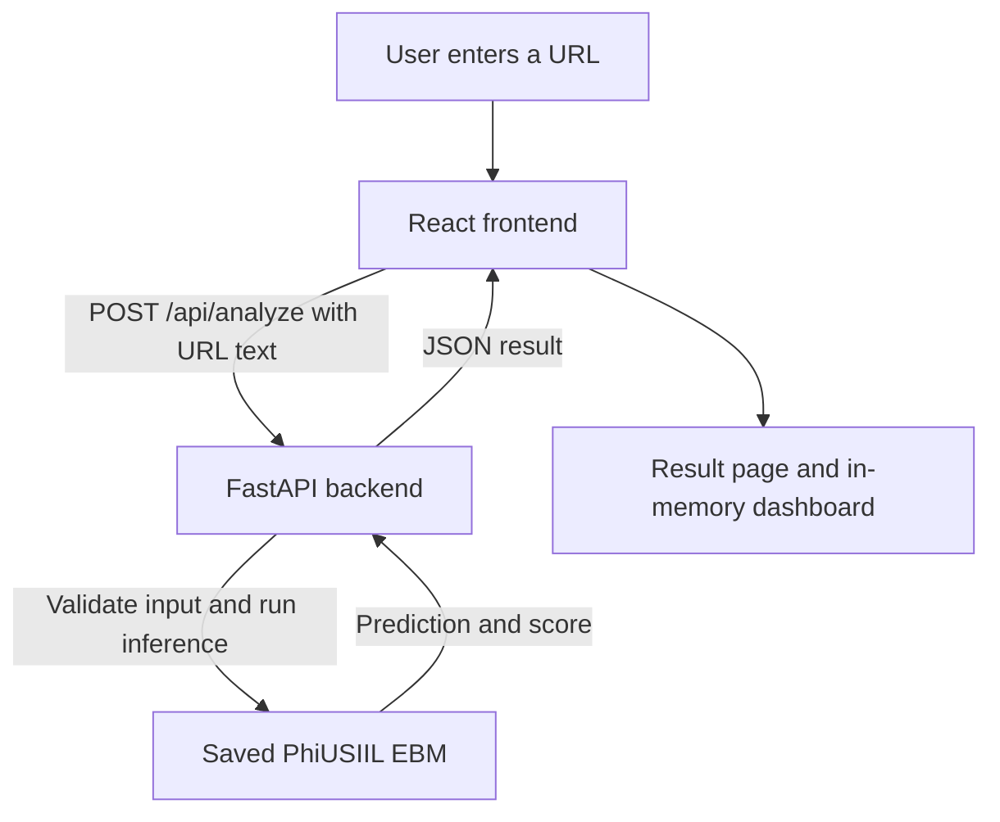

# Checkie — Phishing URL Detector

Checkie estimates phishing risk from the text of a URL and shows a trust score and URL indicators. The FastAPI backend loads the saved PhiUSIIL EBM and its 26 features at startup. It does not open the submitted URL or fetch the destination. A lower predicted risk does not establish that a site is safe.

## Architecture



FastAPI loads the saved model at startup. Checkie analyses the submitted
URL as text and never visits the destination.

## Run locally

Install Git, Python 3.11, and Node.js with npm. Installing dependencies requires internet access. The saved model is included, so you do not need to download the training datasets or retrain the model to run the app.

If you do not already have the repository, clone it:

```sh
git clone https://github.com/TzeShen/COS30049-Computing-Technology-Innovation-Project.git
cd COS30049-Computing-Technology-Innovation-Project
```

### Terminal 1: Start the FastAPI backend

On Windows (PowerShell), from the repository root:

```powershell
cd backend
py -3.11 -m venv .venv
.\.venv\Scripts\python.exe -m pip install --upgrade "pip==26.3"
.\.venv\Scripts\python.exe -m pip install -r requirements.txt
.\.venv\Scripts\python.exe -m pip install --no-deps --no-build-isolation -e .
.\.venv\Scripts\python.exe -m uvicorn app.main:app --host 127.0.0.1 --port 8000
```

On macOS or Linux, from the repository root:

```sh
cd backend
python3 -m venv .venv
./.venv/bin/python -m pip install --upgrade "pip==26.3"
./.venv/bin/python -m pip install -r requirements.txt
./.venv/bin/python -m pip install --no-deps --no-build-isolation -e .
./.venv/bin/python -m uvicorn app.main:app --host 127.0.0.1 --port 8000
```

Keep this terminal open. Visit [the health endpoint](http://127.0.0.1:8000/api/health). It should report `status: "ready"`, `model_loaded: true`, and `feature_count: 26`.

### Terminal 2: Start the React frontend

Open a second terminal in the repository root. On Windows (PowerShell):

```powershell
cd frontend
npm.cmd ci
npm.cmd run dev
```

On macOS or Linux:

```sh
cd frontend
npm ci
npm run dev
```

Keep both terminals running and open [http://127.0.0.1:5173](http://127.0.0.1:5173). Use that address for the local setup. If the frontend cannot reach the API, check that the backend is running on port `8000` and the frontend is on port `5173`.

## Try the dashboard

Paste these addresses into Checkie one at a time:

| URL | Expected model result |
| --- | --- |
| `https://www.example.org` | Lower predicted risk |
| `http://192.0.2.1/verify-account` | Potential phishing |

Open **Dashboard** without reloading the page. A fresh session with these two checks should show **2 total checks, 1 lower predicted risk, and 1 potential phishing**. History resets when the page reloads.

## API

| Method and route | Purpose |
| --- | --- |
| `GET /api/health` | Checks whether the saved model is ready. |
| `POST /api/analyze` | Accepts JSON such as `{"url":"https://www.example.org"}` and returns a trust score, prediction, model contributions, and URL indicators. |
| `GET /docs` | Opens the interactive FastAPI documentation. |

The current app uses `backend/` and `frontend/`. The root `src/` contains earlier project work. Flask is not needed to run this version.

## Threat model (§2.6)

**Scope.** This model covers the local Checkie demo: the React frontend on
`127.0.0.1:5173` and the FastAPI backend on `127.0.0.1:8000`. The user
enters a URL, React sends the text to `POST /api/analyze`, FastAPI validates
it and runs the saved model, and React displays the result. Checkie does
not open or fetch the submitted destination.

**Assets and trust boundaries.** The main assets are the submitted URL text,
the integrity of the saved model and feature definitions, and the availability
of the analysis API. URL text is untrusted when it enters the frontend and
remains untrusted when it reaches FastAPI. The backend also relies on the
integrity of the model files and software dependencies installed locally.

| Threat | Current control | Remaining risk |
| --- | --- | --- |
| Repeated analysis requests consume model resources. | FastAPI allows two concurrent inference calls per process. If both slots are occupied, it returns `503`. The health check does not use an inference slot. | This limits concurrent inference. It does not limit how often a client can send requests. |
| Malformed input causes processing errors, or a submitted URL leads to an unwanted network request. | The backend validates the input, limits URL length to 2,048 characters, and analyses the text without fetching the destination. | A valid URL can still be misclassified. A lower predicted risk does not establish that the destination is safe. |
| Another site embeds Checkie, or the browser interprets a response as the wrong content type. | Vite preview sends a Content Security Policy and `X-Frame-Options: DENY`. The frontend preview and FastAPI send `X-Content-Type-Options: nosniff`. | The frontend headers were tested in Vite preview. A different deployment must configure and verify its own response headers. |
| A submitted URL contains a private path or token. | The browser keeps analysis history in memory and clears it on reload. The submitted URL is sent to the local API for analysis. | URLs and results can still be visible in browser developer tools or captured by a proxy such as ZAP. Use public example URLs for demos and screenshots. |
| A vulnerable dependency or a modified model file affects the result or the app. | We audited the installed frontend and backend dependencies and updated flagged tooling. The backend loads the included model files at startup. | Dependency audits cover known issues in the packages they check. They do not verify that the model files have not been modified. |

**Likely attackers.** A phisher may submit URLs to see whether Checkie
classifies them as lower risk. Someone with access to the API may also
send repeated analysis requests to consume inference resources. A client
can submit URL text directly to the API, so the backend validates it
independently of the React form.

**Risks outside this design.** Checkie does not fetch submitted URLs or
pass them to a shell. It has no database, file uploads, or user accounts.
That removes the paths for server-side request forgery through submitted
URLs, command injection through URL processing, SQL injection, unsafe
uploads, and access to another user's records.

**Priority and verification.** We prioritised API availability because each
accepted analysis runs the model. We verified that occupied inference slots
produce a `503` and that analysis works again when a slot is released. We
also prioritised missing security headers because ZAP flagged them on the
local app. The comparison below records which warnings disappeared after
the changes.

Reference: [OWASP Threat Modeling Cheat Sheet](https://cheatsheetseries.owasp.org/cheatsheets/Threat_Modeling_Cheat_Sheet.html)

## Security defences (§2.7)

1. **Denial of service:** The API limits model inference to two concurrent
   calls per server process. When both slots are occupied, it returns
   `503 INFERENCE_BUSY`. A controlled test verified the busy response and
   confirmed that analysis resumed after a slot was released.

2. **Misconfiguration and vulnerable dependencies:** We audited the
   frontend and backend dependencies, updated flagged tooling, and added
   HTTP security headers. The ZAP comparison below records the results.

## ZAP passive security test

We used ZAP to compare Checkie's local frontend and API before and after adding HTTP security headers. The test covered the frontend homepage on port `5173` and the FastAPI backend on port `8000`.

| Finding | Before | After |
| --- | --- | --- |
| Missing Content Security Policy | Flagged on the frontend homepage | Vite preview returned a `Content-Security-Policy` header. |
| Missing anti-clickjacking protection | Flagged on the frontend homepage | Vite preview returned `X-Frame-Options: DENY` and the CSP directive `frame-ancestors 'none'`. |
| Missing `X-Content-Type-Options` | Flagged on frontend and API responses | The frontend and API returned `X-Content-Type-Options: nosniff`. |

In the fresh ZAP session, the homepage, the analysis preflight (`OPTIONS /api/analyze`), the analysis request (`POST /api/analyze`), and the health check (`GET /api/health`) all returned `200 OK`. ZAP did not report the three targeted warnings again for the tested Checkie URLs. An informational alert remained on the homepage. Unrelated Edge and MSN traffic was excluded from the comparison.

### Repeat the passive check

Keep FastAPI running. Stop the Vite development server if it is using port `5173`. From the `frontend` directory on Windows, run:

```powershell
npm.cmd run build
npm.cmd run preview -- --host 127.0.0.1 --port 5173 --strictPort
```

On macOS or Linux, run the same commands using `npm` in place of `npm.cmd`. The frontend security headers are configured for Vite preview.

In a fresh ZAP session, launch a browser through **Manual Explore** and visit `http://127.0.0.1:5173/`. Submit `https://www.example.org` through Checkie, then visit `http://127.0.0.1:8000/api/health` in the same browser. Check the response headers in **History → Response** and review the **Alerts** entries for the two local addresses.